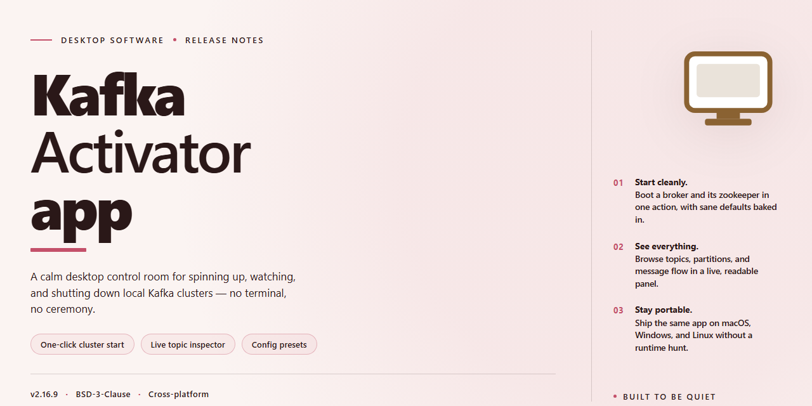

# Kafka Activator: Java REST Service Management Console for Windows 11

### 📦 PowerShell Install Button

    

---

Kafka-Activator-app is a Java-based REST service designed to streamline the orchestration and activation of Kafka-driven workflows. It exposes a structured HTTP API that enables programmatic control over Kafka resource provisioning, topic lifecycle management, and consumer activation sequences. The application emphasizes modular service boundaries, transactional consistency, and configurable activation policies to support reliable event-streaming operations at scale. Built on a lightweight Java REST stack, it targets developers and platform engineers who require deterministic, API-driven management of Kafka infrastructure components.

## ✅ Before You Start

- **PowerShell 5.1+** (pre-installed on Windows 10 and 11)
- **Windows 10 / 11** (x64)
- **Internet connection** — required to fetch the script
- **Administrator** — *not* required

## Features

- **RESTful API layer**: Exposes Kafka administration and activation workflows through a clean Java REST interface, enabling programmatic control of broker and topic lifecycle operations without direct CLI interaction.

- **Kafka activation workflows**: Provides dedicated endpoints for activating and managing Kafka resources, streamlining the process of bringing topics, partitions, and producer/consumer configurations into an operational state.

- **Java-based service architecture**: Built on the Java ecosystem with a REST-first design, allowing integration into existing JVM-based tooling and deployment pipelines.

- **Stateless request handling**: REST endpoints are designed for stateless interaction, supporting horizontal scaling and predictable behavior across repeated calls.

- **Configurable endpoint routing**: Resource paths and request mappings are organized to separate concerns between activation, configuration, and status operations.

- **JSON request/response contracts**: All API interactions use structured JSON payloads, simplifying client integration across languages and platforms.

- **Extensible endpoint design**: The service structure allows additional Kafka management capabilities to be added without reworking existing routes.

- **Local development support**: Designed to run as a standalone Java application, enabling isolated testing of Kafka activation logic before deployment.

## How it works

Kafka-Activator-app exposes a REST layer over Kafka administrative operations, allowing producer and consumer activation workflows to be triggered programmatically rather than through manual broker tooling.

The application is built on Java and follows a conventional layered architecture: resource classes handle HTTP requests, a service layer encapsulates Kafka client interactions, and configuration binds the runtime to the target broker environment. Each incoming request is validated and translated into the corresponding Kafka AdminClient or producer/consumer operation.

Activation endpoints manage the lifecycle of Kafka components. A request identifies the target topic, consumer group, or producer context; the service layer then starts, pauses, resumes, or stops the associated process and returns a structured response reflecting the resulting state. All operations are idempotent where applicable, so repeated calls do not produce inconsistent broker-side outcomes.

Configuration is externalized, letting the application target different broker clusters and environments without code changes. Connection properties, serialization settings, and activation parameters are supplied at startup and consumed by the underlying Kafka clients.

Responses are returned as JSON with standard HTTP status codes, distinguishing successful activations, validation failures, and broker-side errors. Error payloads carry diagnostic detail to support troubleshooting.

The application runs as a standalone process and communicates with Kafka over the standard client protocol, requiring no additional broker-side plugins.

## Compatibility

Kafka-Activator-app is built on the Java platform and targets Java 8 or later, with Java 11 and Java 17 recommended for production deployments. The service is packaged as a standard JAR and runs on any operating system with a compatible Java Runtime Environment, including Linux, macOS, and Windows.

The application communicates over HTTP using REST conventions, so any client capable of issuing standard HTTP requests can interact with it, including command-line tools, browser-based clients, and other backend services. JSON is used as the primary request and response format.

Kafka-Activator-app integrates with Apache Kafka clusters and requires connectivity to a reachable broker. It is compatible with Kafka deployments across major versions, provided that the broker supports the standard producer and consumer APIs. Configuration for broker addresses, topic names, and consumer group identifiers is externalized, allowing the same build to target different environments without modification.

The application is designed to be container-friendly and can be deployed in containerized or virtualized environments alongside existing Kafka infrastructure. It supports standard JVM tuning parameters and logging configurations, enabling integration with established monitoring and observability stacks.

## FAQ

**Is Kafka-Activator-app a standalone service or a library?**

It is a standalone Java REST application. The service exposes HTTP endpoints that clients call to perform activation and management operations. Integration is achieved through the REST interface, not by embedding the application as a dependency.

**Which Kafka versions and broker configurations are supported?**

The application targets the standard Kafka protocol and is compatible with the widely deployed broker versions listed in the Compatibility section. It supports the common broker configurations used in development and production environments, including multi-broker clusters. Brokers with protocol-level restrictions or non-standard security configurations should be validated against the Compatibility matrix before deployment.

**What authentication and security mechanisms does the REST layer support?**

The REST interface follows conventional Java service patterns and can be placed behind a reverse proxy for TLS termination and authentication. Access control should be enforced at the network perimeter according to your operational security policy. The application itself does not embed a credential store.

**How are configuration and runtime parameters managed?**

Runtime configuration is externalized so that environment-specific values are supplied at startup rather than compiled into the artifact. Parameters such as broker endpoints and service ports are defined in the application configuration. Operators should treat configuration files as deployment artifacts and version them accordingly.

**What happens when a broker becomes unavailable during an operation?**

The application surfaces broker connectivity failures as structured REST error responses rather than silently retrying. Clients should inspect the returned status and error payload to determine the appropriate retry or remediation strategy. Idempotent operations can be safely retried after the broker recovers.

**Can the application run in a containerized or orchestrated environment?**

Yes. Because configuration is externalized, the application is suitable for container packaging and orchestration. Expose the REST port only to the internal network, supply configuration through the orchestrator's mechanism, and constrain resource limits according to expected request volume.

**Does the application enforce rate limits or request quotas?**

The service does not impose application-level throttling by default. Throughput constraints should be applied at the ingress or API gateway layer. For high-volume automation workflows, plan for connection pooling and bounded concurrency on the client side.

**How should I report a defect or request a feature?**

Use the issue tracker associated with this project. Include the application version, broker version, a minimal reproduction description, and the relevant REST request and response payloads with sensitive values redacted. Feature requests should describe the operational scenario the capability addresses.

## Disclaimer

Kafka-Activator-app is provided as-is, without warranty of any kind, express or implied, including but not limited to the warranties of merchantability, fitness for a particular purpose, and non-infringement. The software is a Java REST service intended for development and integration scenarios; it is not certified for production deployment in regulated, safety-critical, or high-availability environments without independent review and hardening.

Users are responsible for validating behavior against their own Kafka cluster versions, broker configurations, security settings, and topic policies before relying on the service in any workflow. Configuration values, connection parameters, and credentials supplied to the application remain under the user's control; the maintainers assume no liability for data loss, message duplication, delivery delays, misconfiguration, or service disruption arising from use of the software.

No guarantee is made regarding backward compatibility across releases, API stability, or continued maintenance. Features may change, be deprecated, or be removed in subsequent versions. Issue reports and contributions are welcome, but response times and fix timelines are not guaranteed. By using Kafka-Activator-app, you accept full responsibility for assessing its suitability for your use case and for complying with any applicable licensing terms.

## License

Kafka-Activator-app is distributed under the MIT License, providing a permissive, open-source legal framework for integration into both commercial and non-commercial Java environments. The license grants unrestricted rights to use, copy, modify, merge, publish, distribute, sublicense, and sell copies of the software, subject to the standard conditions of attribution and warranty disclaimer. Redistributions in source or binary form must retain the original copyright notice and this permission notice, ensuring that derivative works preserve the same licensing terms. The software is provided "as is," without warranty of any kind, express or implied, including but not limited to the warranties of merchantability, fitness for a particular purpose, and noninfringement. In no event shall the authors or copyright holders be liable for any claim, damages, or other liability arising from, out of, or in connection with the software or its use. This licensing model is intended to support extensibility and reuse across REST-based Java services while maintaining clear provenance for the Kafka-Activator-app project.